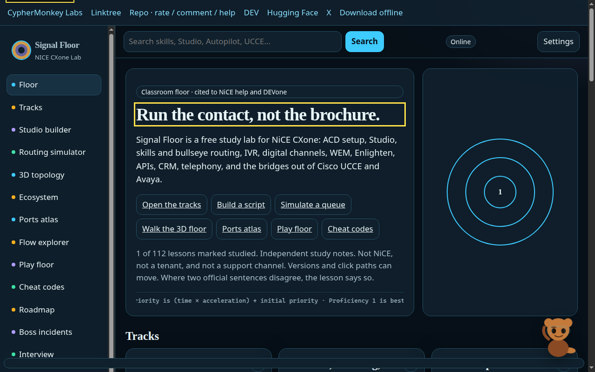
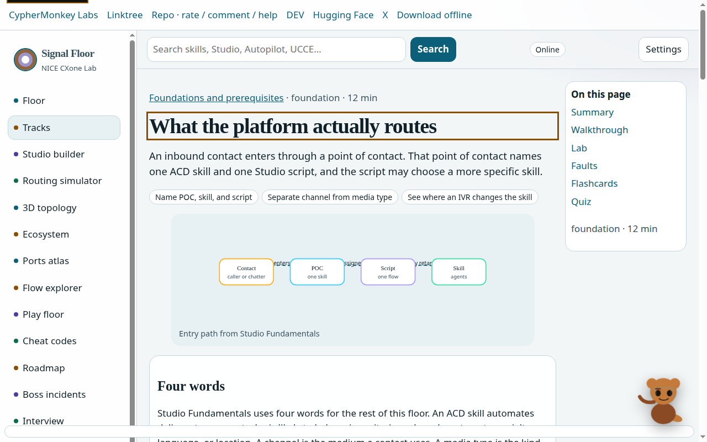
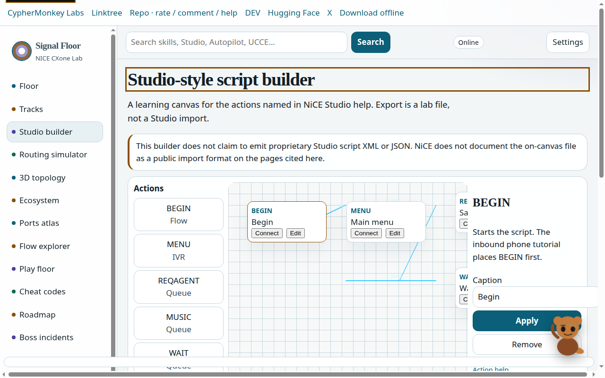
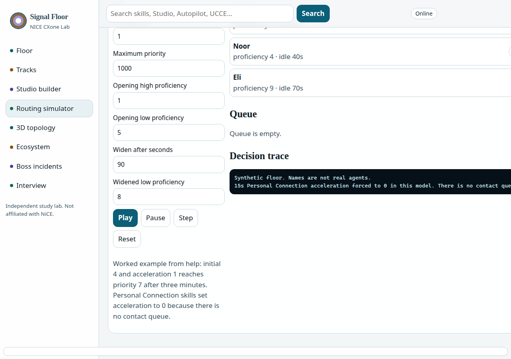
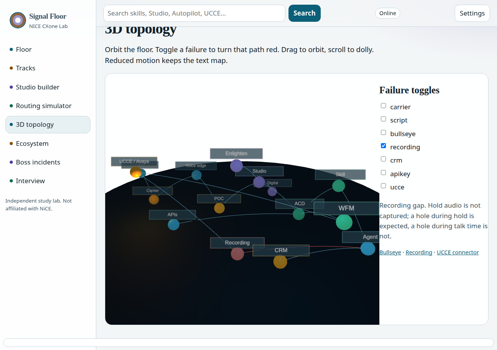
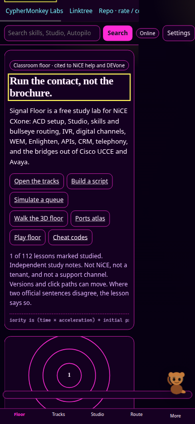

# NICE CXone Lab

Signal Floor is a free, static study campus for NiCE CXone. It covers ACD setup, Studio scripting, skills and routing, IVR, digital channels, workforce management, quality and recording, Enlighten Autopilot and AutoSummary, CXone APIs, CRM integrations, telephony, and bridges from Cisco UCCE and Avaya.

It is independent study material. It is not affiliated with NiCE. The Studio builder exports a classroom JSON file, not an official Studio script. The routing simulator uses the documented priority formula and labels its tie-break as a classroom rule.

## Run it locally

From the repository root:

```bash
python3 -m http.server 41773
```

Open [http://127.0.0.1:41773/campus/](http://127.0.0.1:41773/campus/). The root `index.html` redirects to `campus/`.

GitHub Pages works the same way: publish the repository and start at `campus/`. Routes are hash URLs, so no server rewrites are required.

## Floor













## What you can do

- Study 16 tracks. Each lesson has a figure, a Play / Pause / Step / Inspect walkthrough, a lab, a fault-and-fix, flashcards, and a quiz.
- Build a Studio-style script, validate it, and export it. The file is marked `notOfficialStudioExport`.
- Run the routing simulator. Overall priority is `(time × acceleration) + initial priority`. Personal Connection mode forces acceleration to 0.
- Orbit a 3D topology and force a failure. Reduced motion, or a browser without WebGL, falls back to a list. Three.js is vendored. Nothing is loaded from a CDN at runtime.
- Read the ecosystem glossary, work synthetic boss incidents, and practice interview answers that stay inside the cited page.
- Switch among Signal (dark), Daylight, High contrast, and Dusk. Sound, narration, speech rate, reduced motion, and font size persist in `localStorage`. Narration waits for `voiceschanged` and will not silently start on a robotic Edge voice.

## Rebuild the lessons

Lesson source lives in `tools/`. The campus reads generated JSON.

```bash
node tools/build.mjs
node scripts/verify.mjs
```

`verify.mjs` checks track, lesson, quiz, lab, and fault counts, citation URLs, the priority example (initial 4, acceleration 1, 3 minutes → 7), one static `h1`, theme tokens, the 640px navigation, and that Three.js is local.

## Citations

Every lesson links to a public NiCE help page, the NiCE developer portal, an RFC, the OpenID Connect spec, or a Credly badge. Where two official sentences disagree, the lesson is marked uncertain. Examples:

- A priority page sentence that says initial priority 3 “starts at 4” does not match the formula at time zero.
- An OpenID Connect section contains a password-grant sample. User apps in this lab follow the authorization-code branch.
- The 26.3 cycle and the 26.4 Coming Soon window overlap. Both dates are quoted.
- English 25.4 release notes were not available when this campus was written. The French 25.4 page is cited instead.
- The WFM UCCE connector page says version 11.6. The Multi-ACD recording table says UCCE 12.6 and 15. They are different products.
- No exam codes, prices, SIP header lists, or Webex versions are invented.

## University layer

The floor adds a ports atlas, flow explorer, call-flow sandbox, play floor, cheat-code downloads, and a CypherMonkey mascot. Themes are Signal, Futuristic, Gaming, Neon, Light, High contrast, and Dusk.

Rebuild the atlas and the one-page sheets with:

```bash
node tools/atlas.mjs
node tools/sheets.mjs
node scripts/verify.mjs
```

Sheets live in `campus/downloads/`. They paraphrase public pages and link to them.

## License

Code is MIT. Lesson text in this release is CC BY-NC-SA 4.0. The v1.0 snapshot remains CC BY 4.0. three.js remains under its own MIT license. See `LICENSE`.
